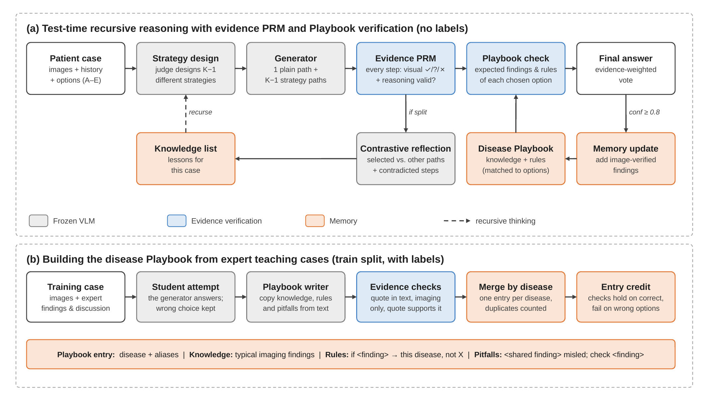

# Evidence Process Rewards and Verified Memory for Test-Time Reasoning

Test-time self-improvement for frozen vision-language models on multi-image diagnosis questions.

- **Evidence PRM.** Each sampled reasoning path is split into steps, and a VLM judge grades every step twice: is the visual statement supported by the images, and is the inference valid. Paths are combined by an evidence-weighted vote.
- **Disease Playbook.** One entry per disease with knowledge (typical imaging findings) and rules (discriminators and pitfalls), copied from expert teaching cases and kept only if a quote supports them. The Playbook is never shown to the generator; it is only used to check the findings of each candidate answer on the images.
- **Recursive thinking.** Strategy design and contrastive reflection in the style of TRT, with contradicted steps fed back as lessons.



## Results

Accuracy (%) on the MedThinkVQA test split (720 cases). Δ is the change from CoT.

| Method | Qwen3-VL-4B | Δ | Qwen3-VL-8B | Δ |
|---|---|---|---|---|
| CoT (greedy) | 27.4 | – | 31.3 | – |
| Self-Consistency (K=4) | 29.4 | +2.0 | 32.7 | +1.4 |
| ACE | 30.2 | +2.8 | 33.8 | +2.5 |
| TRT | 31.0 | +3.6 | 34.5 | +3.2 |
| **Ours** | **45.2** | **+17.8** | **48.9** | **+17.6** |

## Setup

```bash
pip install -r requirements.txt
```

Two vLLM servers are started automatically: the generator and the judge (Qwen3-VL-8B-Instruct, FP8). Each needs one GPU with about 14 GB and 21 GB free memory; with a single GPU the generator also acts as the judge.

## Usage

```bash
python run.py --limit 720 --gen-model Qwen/Qwen3-VL-4B-Instruct
python run.py --limit 720 --gen-model Qwen/Qwen3-VL-8B-Instruct
```

Other settings are in `verimem/config.py`. The dataset must have `train` and `test` splits with images, clinical history, options, and expert findings/discussion on the training split.

Outputs in `results/`:
- `summary_*.json`: accuracy of each stage, PRM pair accuracy, token cost
- `per_case_*.jsonl`: predictions per case
- `playbook_*.txt`: the final Playbook with quotes

## Code

```
run.py               entry point: build Playbook, estimate credit, run test stream
verimem/config.py    default settings
verimem/data.py      dataset loading
verimem/serving.py   vLLM servers and chat calls
verimem/playbook.py  Playbook construction, quote checks, checklist verification, credit
verimem/prm.py       evidence PRM and answer selection
verimem/search.py    strategy design, recursion, verified writing
```
